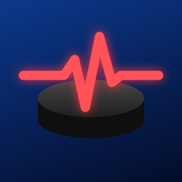
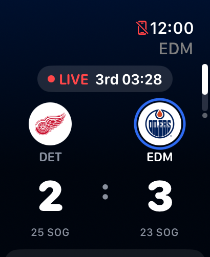
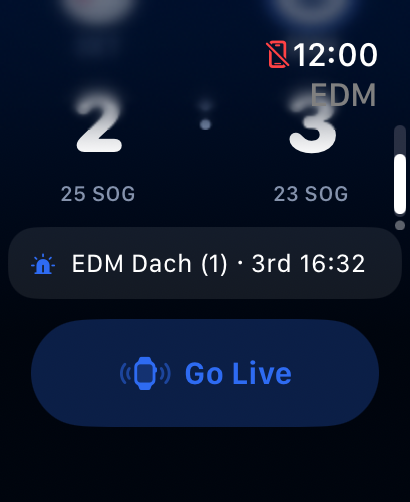
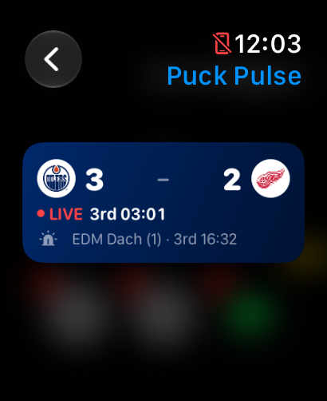
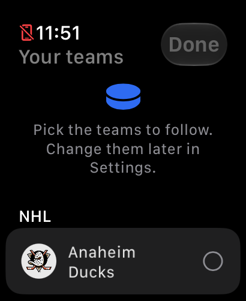
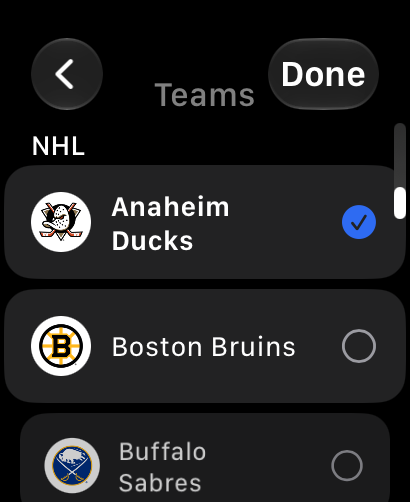
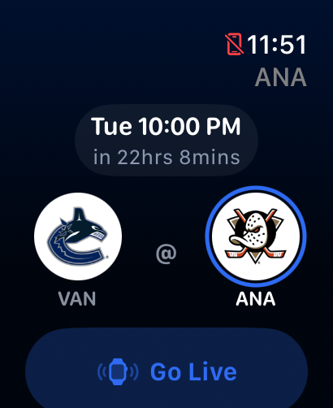
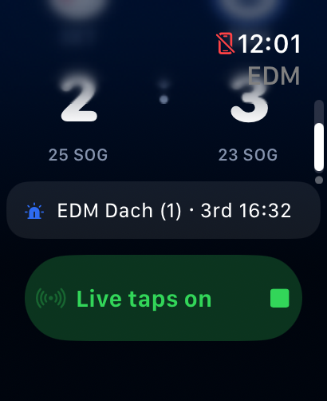
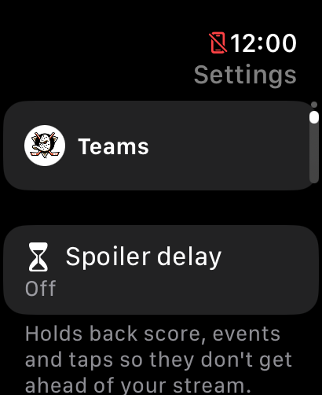

# Puck Pulse

An Apple Watch app that follows your NHL teams live and taps your wrist when something happens:
goals, penalties, power plays, period breaks and the final horn. Each event has its own haptic
pattern, so you know what happened without looking.

Scores come from the public NHL web API (`api-web.nhle.com`), polled every 8 s during a game.
No account, no server, no phone app: everything runs on the watch.

<p align="center">
  
  
  
</p>

## Features

### Follow any teams

Pick your teams on first launch and change them later in Settings → Teams. Each followed game
gets its own page, with live games first.

<p align="center">
  
  
</p>

### Game page

Before puck drop: start time with a countdown. During the game: a red **LIVE** pill with period
and clock, team logos, score and shots on goal, and a card with the power-play state
(PP 5v4, PK, empty net), the player in the penalty box and the last goal.

<p align="center">
  
  
  
</p>

### Haptics

| Event | Pattern |
|---|---|
| Your team scores | three strong taps |
| Opponent scores | one buzz |
| Goal overturned | two retry taps |
| Your team on the power play | four even taps |
| Your team short-handed | quick double tap |
| Period start | one tap |
| Period end, final | two taps, pause, one tap |

Every event can be switched off in Settings, which also plays each pattern so you can learn them.
watchOS has no continuous-vibration API, so all patterns are made of taps.

### Live mode with the screen off

Tap **Go Live** before or during a game. watchOS normally suspends an app seconds after you
lower your wrist, so Live mode starts a workout session with no workout builder: it keeps the
app running for the whole game and nothing is saved to Health. If Health access is declined, it
falls back to an extended runtime session, which watchOS caps at about an hour. Live mode ends
by itself at the final horn. It does not silence other notifications.

At each puck drop a notification with a **Go Live** button starts Live mode in one tap. Alerts
for the next 20 games across all your teams are scheduled whenever the app runs and refreshed in
the background.

### Spoiler delay

Settings → Spoiler delay (10 s to 5 min) holds back the score, events, taps and the widget so
they don't get ahead of a delayed stream.

<p align="center">
  
</p>

### Smart Stack widget

Shows the next game with a countdown, or the live score with a red LIVE dot, followed by the
active penalty or the last goal. From 15 minutes before puck drop it asks watchOS to raise it in
the Smart Stack until Live mode is on, and tapping it starts Live mode. Circular and inline
complications are included; on tinted watch faces logos are replaced by team abbreviations.

## Build

Step-by-step instructions, including watch setup, signing and troubleshooting, are in
[INSTALL.md](INSTALL.md). The short version:

Requirements: Xcode 27, an Apple Watch on watchOS 11 or later (or the simulator).

1. Fetch the team logos. They are NHL trademarks, so they are not in the repo; the script
   downloads the official SVGs and renders them into a gitignored asset catalog. Without them
   the app shows team abbreviations.

   ```bash
   ./scripts/fetch-logos.sh
   ```

2. Put your signing team in `watch/Config/Secrets.xcconfig` (gitignored):

   ```
   DEVELOPMENT_TEAM = <team id>
   ```

3. Build and install on the watch:

   ```bash
   cd watch
   xcodebuild -project PuckPulse.xcodeproj -scheme PuckPulse \
     -destination 'platform=watchOS,id=<watch udid>' -derivedDataPath build -allowProvisioningUpdates
   xcrun devicectl device install app --device <watch udid> build/Build/Products/Debug-watchos/PuckPulse.app
   ```

With a free Personal Team the signing expires after 7 days, so rebuild and reinstall weekly.

## Project layout

| Path | What |
|---|---|
| `watch/PuckPulse/` | Watch app: tracker, event detection, haptics, notifications, views |
| `watch/PuckPulseWidget/` | Smart Stack widget and complications |
| `watch/Shared/` | NHL API client and models, team list, widget state, logo view |
| `watch/Config/` | Info.plists, entitlements, build settings |
| `scripts/fetch-logos.sh` | Downloads team logos into the gitignored asset catalog |
| `scripts/make-icon.swift` | Draws the app icon |
| `docs/` | README icon and screenshots |

Bundle ids (`com.yakavetsiv.leafslive.watchkitapp`) and the App Group
(`group.com.yakavetsiv.leafslive`) keep the app's original name so existing installs update in place.

## Notes

Not affiliated with the NHL. Team names and logos belong to the NHL and its teams; logos are
fetched at build time and are not distributed with this repository.

[MIT License](LICENSE)
